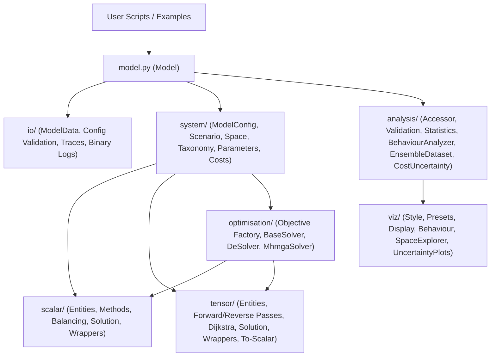

# `firm_ce` Codebase Architecture & Module Documentation

## Overview
**FIRM_CE** (Flexible Integrated Renewable Energy Model — Capacity Expansion) is a Numba-accelerated long-term electricity capacity expansion and chronological unit commitment simulation framework. Given multi-year weather and demand time-series, asset cost assumptions, and transmission topology, it searches for least-cost and near-optimal generation, storage, and transmission portfolios using either Differential Evolution (`single_time`) or Niching Evolutionary Modelling to Generate Alternatives (`nemga`).

---

## High-Level Architecture & Dependency Layers

---

## Subpackage Directory Index

| Layer | Module / Subpackage | Documentation Link | Purpose |
| :--- | :--- | :--- | :--- |
| **Top** | `src/firm_ce/model.py` | [`docs/model.md`](./docs/model.md) | Top-level `Model` orchestrator for data loading, validation, solving, and post-processing. |
| **Layer 0** | `src/firm_ce/common/` | [`docs/common/README.md`](./docs/common/README.md) | Global constants, Numba `@njit`/`@jitclass` fallbacks, custom exceptions, logging, and type definitions. |
| **Layer 1** | `src/firm_ce/io/` | [`docs/io/README.md`](./docs/io/README.md) | CSV/Parquet file managers, `ModelData` container, pre-solve schema validation, time-series trace loading/aggregation, and binary population log conversion/recovery. |
| **Layer 2** | `src/firm_ce/system/` | [`docs/system/README.md`](./docs/system/README.md) | `ModelConfig`, `Scenario`, decision-space indexing & MGA projection matrices (`space.py`), domain `TechTaxonomy` (`taxonomy.py`), `ScenarioParameters` (`parameters.py`), and shared `@njit` cost/PHES math (`costs_common.py`). |
| **Layer 3A** | `src/firm_ce/scalar/` | [`docs/scalar/README.md`](./docs/scalar/README.md) | Scalar backend: `@jitclass` entities & constructors (`entities/`), `@njit` pseudo-methods (`methods/`), chronological unit commitment & deficit-block precharging (`balancing.py`), `Solution` (`solution.py`), and parallel population wrappers (`wrappers.py`). |
| **Layer 3B** | `src/firm_ce/tensor/` | [`docs/tensor/README.md`](./docs/tensor/README.md) | Tensor backend: contiguous 2D/3D `@jitclass` entities (`entities/`), forward/reverse sweep simulation (`dynamics.py`, `forward_pass.py`, `reverse_pass.py`, `interconnection.py`, `simulation.py`), `SolutionTensor` (`solution.py`), thread-pooled MGA wrappers (`wrappers.py`), and tensor-to-scalar adapter (`to_scalar.py`). |
| **Layer 4** | `src/firm_ce/optimisation/` | [`docs/optimisation/README.md`](./docs/optimisation/README.md) | Objective routing factory (`objective_factory.py`), abstract solver base & SIGINT handling (`base.py`), Differential Evolution solver (`de_solver.py`), and MHMGA solver (`mhmga_solver.py`). |
| **Layer 5** | `src/firm_ce/analysis/` | [`docs/analysis/README.md`](./docs/analysis/README.md) | Headless post-processing: `Accessor`, `Validation` / `ValidationTensor`, Polars/Parquet `Statistics`, `BehaviourAnalyzer` (`behaviour_calc.py`), `EnsembleDataset` (`ensemble.py`), and Monte-Carlo cost uncertainty (`cost_uncertainty.py`). |
| **Layer 6** | `src/firm_ce/viz/` | [`docs/viz/README.md`](./docs/viz/README.md) | Matplotlib/GeoPandas/Seaborn visualisation suite: `PlotStyle` & palettes (`style.py`), `MetricSpec` presets (`presets.py`), spatial & summary charts (`display.py`), diurnal/raw trace plots (`behaviour_plots.py`), `SpaceExplorer` (`space_explorer.py`), and Monte-Carlo rank/win-rate plots (`uncertainty_plots.py`). |
