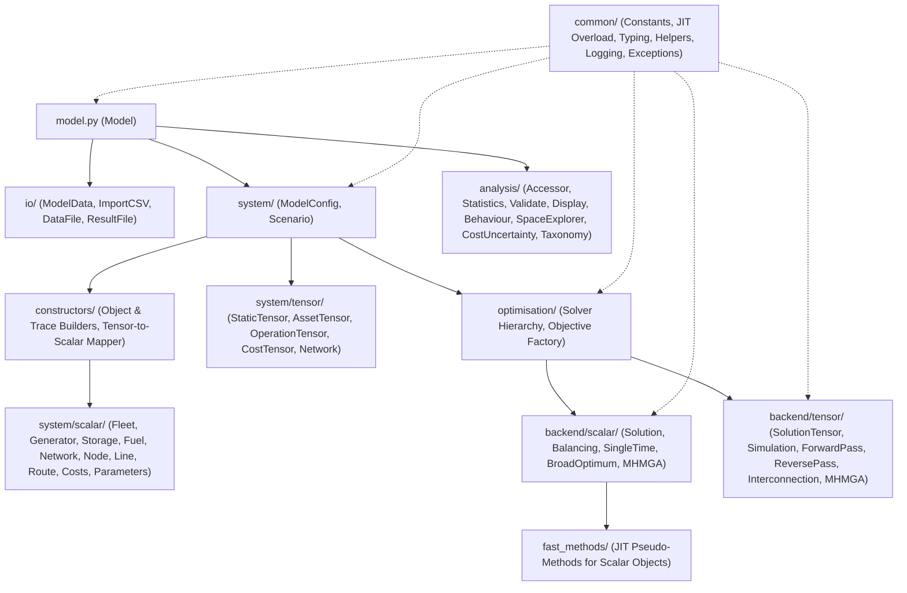

# `firm_ce` Codebase Architecture & Module Documentation

`firm_ce` (**FIRM Capacity Expansion** / **FIRMEurope**) is a long-term electricity system planning, operational simulation, and near-optimal space exploration (Modelling to Generate Alternatives — MGA / MHMGA) framework. It couples heuristic/rule-based chronological unit commitment and transmission dispatch (compiled to native machine code via **Numba**) with population-based metaheuristic optimisers (**Differential Evolution** and **Metapopulation Historical Modelling to Generate Alternatives — MHMGA**).

---

## High-Level Architecture

The codebase is organised into eight subpackages under [`src/firm_ce/`](./src/firm_ce) plus the top-level [`model.py`](./src/firm_ce/model.py) entry point:

### Dual-Backend Design (`scalar` vs. `tensor`)

A central architectural feature of `firm_ce` is its support for two interchangeable simulation backends configured via `backend` in `config.csv`:

1. **Scalar Backend ([`system/scalar/`](./src/firm_ce/system/scalar) + [`fast_methods/`](./src/firm_ce/fast_methods) + [`backend/scalar/`](./src/firm_ce/backend/scalar))**:
   - Represents individual assets (`Generator`, `Storage`, `Fuel`, `Node`, `Line`, `Route`) as Numba `@jitclass` instances.
   - Uses a static/dynamic copy pattern (`create_dynamic_copy`) inside parallel worker threads so static time-series traces are shared across threads while endogenous state arrays are allocated per evaluation.
   - Simulates chronological interval-by-interval dispatch and reverse-time deficit-block precharging along pre-enumerated multi-leg `Route` objects.

2. **Tensor Backend ([`system/tensor/`](./src/firm_ce/system/tensor) + [`backend/tensor/`](./src/firm_ce/backend/tensor))**:
   - Aggregates assets by node and technology tier into contiguous NumPy/Numba arrays (`StaticTensor`, `AssetTensor`, `OperationTensor`, `CostTensor`).
   - Pre-allocates a thread-local pool of `SolutionTensor` buffers (`ResetSolution`) to eliminate heap allocations during population evaluations.
   - Executes a multi-stage horizon sweep (`ForwardPassRenewables` $\rightarrow$ `ReversePassHydro` $\rightarrow$ `ForwardPassPeak` $\rightarrow$ `ReversePassPeak`) using an inline Dijkstra maximum-efficiency pathfinder (`Interconnection`) over a CSR adjacency graph.
   - Maps evaluated `SolutionTensor` instances back to scalar `Solution` objects via [`map_tensor_to_scalar`](./src/firm_ce/constructors/tensor_to_scalar.py#L19-L186) so downstream post-processing and plotting tools work seamlessly across both backends.

---

## Module Documentation Index

| Module / Subpackage | Documentation File | Purpose |
| :--- | :--- | :--- |
| **`firm_ce.model`** | [`docs/model.md`](./docs/model.md) | Top-level `Model` user interface orchestrating configuration, scenario lifecycle, solving, validation, and result generation. |
| **`firm_ce.common`** | [`docs/common/README.md`](./docs/common/README.md) | Global constants, 32/64-bit Numba/NumPy type aliases, JIT toggle decorators (`JIT_ENABLED`), helper functions, exceptions, and logging setup. |
| **`firm_ce.io`** | [`docs/io/README.md`](./docs/io/README.md) | CSV/Parquet/Excel file I/O (`ImportCSV`, `DataFile`, `ResultFile`), input schema validation (`ModelData`), and time-series interval aggregation. |
| **`firm_ce.system`** | [`docs/system/README.md`](./docs/system/README.md) | `ModelConfig` and `Scenario` orchestration, decision vector indexing, relative/absolute parameterisation, and MGA projection matrices. |
| **`firm_ce.system.scalar`** | [`docs/system/scalar/README.md`](./docs/system/scalar/README.md) | Scalar Numba `@jitclass` data structures (`Fleet`, `Generator`, `Storage`, `Fuel`, `Network`, `Node`, `Line`, `Route`, `UnitCost`, `LTCosts`, `ScenarioParameters`). |
| **`firm_ce.system.tensor`** | [`docs/system/tensor/README.md`](./docs/system/tensor/README.md) | Tensor Numba `@jitclass` data structures (`StaticTensor`, `AssetTensor`, `OperationTensor`, `CostTensor`) and CSR graph builder (`GenerateTensorNetwork`). |
| **`firm_ce.constructors`** | [`docs/constructors/README.md`](./docs/constructors/README.md) | Factory functions that build `@jitclass` instances from validated dictionaries, load/unload time-series traces, and map tensor solutions to scalar solutions. |
| **`firm_ce.fast_methods`** | [`docs/fast_methods/README.md`](./docs/fast_methods/README.md) | `@njit`-compiled procedural operations acting on scalar `@jitclass` instances (dynamic copying, capacity building, merit-order dispatch, LCOE math, route flow updates). |
| **`firm_ce.backend`** | [`docs/backend/README.md`](./docs/backend/README.md) | Overview of the operational simulation and objective evaluation engines (`scalar` vs. `tensor`). |
| **`firm_ce.backend.scalar`** | [`docs/backend/scalar/README.md`](./docs/backend/scalar/README.md) | Scalar `Solution` class, chronological balancing & deficit-block precharging engine, and parallel population wrappers for DE, Broad Optimum, and MHMGA. |
| **`firm_ce.backend.tensor`** | [`docs/backend/tensor/README.md`](./docs/backend/tensor/README.md) | Tensor `SolutionTensor` class, forward/reverse pass simulation engine, Dijkstra `Interconnection` router, and thread-pooled MHMGA population wrappers. |
| **`firm_ce.optimisation`** | [`docs/optimisation/README.md`](./docs/optimisation/README.md) | `ObjectiveBundle` factory (`objective_factory.py`) and solver hierarchy (`SingleTimeSolver`, `BroadOptimumSolver`, `MhmgaSolver`, `MhmgaExtremaSolver`, binary log management). |
| **`firm_ce.analysis`** | [`docs/analysis/README.md`](./docs/analysis/README.md) | Post-processing, validation (`Validation`, `ValidationTensor`), Polars/Parquet statistics export (`Statistics`), unified data access (`Accessor`), taxonomy, and plotting (`Display`, `Behaviour`, `SpaceExplorer`, `cost_uncertainty`). |
