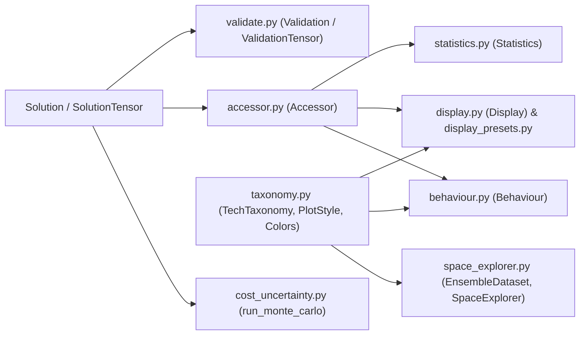

# Module Summary: `firm_ce.analysis`

**Source Folder:** [`src/firm_ce/analysis/`](./src/firm_ce/analysis)

## Overview

The `firm_ce.analysis` subpackage provides post-optimisation verification, data extraction, statistical reporting, taxonomy projection, Monte-Carlo cost-uncertainty analysis, and visualisation tools for both single optimal solutions and large MHMGA near-optimal ensembles.

---

## Contents & Key Functionality

### 1. [`accessor.py`](./src/firm_ce/analysis/accessor.py) — `Accessor`
Provides a unified, unit-aware query interface over an evaluated scalar `Solution` object:
- **Unit Scaling (`update_units`)**: Supports `"GW"`/`"GWh"` (`factor = 1.0`), `"MW"`/`"MWh"` (`factor = 1000.0`), or custom numeric multipliers.
- **Asset Type Predicates & Retrieval**: `is_generator`, `is_storage`, `is_line`, `is_major_line`, `is_minor_line`, `is_node`, `is_fuel`, `is_flexible`, `has_inflows`, `is_solar`, `is_wind`, `is_ror`, `is_baseload`, and `get_assets(asset_class)`.
- **Unified Capacity, Build, Cost & Efficiency Getters**:
  - `get_power_capacity`, `get_energy_capacity`, `get_capacity(asset, attribute, build)`, `get_build_power`, `get_build_energy`.
  - `get_annualised_build_cost`, `get_fixed_om_cost`, `get_variable_om_cost`, `get_fuel_cost`, `get_all_costs`.
  - `get_charge_efficiency`, `get_discharge_efficiency`, `get_round_efficiency`, `get_transm_efficiency`, `get_efficiency`.
- **Dynamic Trace & Gross Energy Routing (`get_trace`, `get_gross`, `__getattr__`)**:
  - Registers 26 time-series metrics in `self._trace_registry` (`power`, `dispatch`, `generation`, `discharge`, `charge`, `charge_loss`, `discharge_loss`, `storage_loss`, `inflow`, `spillage`, `storage_level`, `remaining_energy`, `demand`, `deficit`, `curtail`, `net_flow`, `import`, `export`, `retention`, `nominal_curtailment`, `expected_curtailment`, `post_curtailment_power`, `local_consumption`, `transmission`, `line_loss`, `line_use`).
  - Dynamically resolves `accessor.get_<metric>_trace(asset)` and `accessor.get_<metric>_gross(asset)` for an individual asset, a `Node` (aggregating assets at that node), or `"system"` (aggregating across the entire grid).
  - Includes a cached 4-tier nodal curtailment allocation model (`_compute_nodal_tier_data`) that attributes nodal curtailment to (1) storages & flexibles, (2) solar/wind/RoR, and (4) baseload/other generators.

### 2. [`validate.py`](./src/firm_ce/analysis/validate.py) — `Validation` & `ValidationTensor`
Independently verifies that an evaluated `Solution` (`Validation`) or `SolutionTensor` (`ValidationTensor`) satisfies all physical and operational constraints within `VALIDATION_TOL` (`1e-2`), writing a human-readable `validation_report.txt` (`dump_logs`):
1. **Decision Variables Bounds (`check_build_bounds`)**: Verifies all new-build power and energy capacities lie within `[min_build, max_build]`.
2. **Generator Limits (`check_generator_limits` / `check_dispatch_limits`)**: Checks that interval dispatch is non-negative and never exceeds installed power capacity.
3. **Transmission Limits (`check_transmission_limits`)**: Checks that `|flow| <= capacity` on every major line in every interval.
4. **Energy Balance & Flows (`check_energy_balance_and_flows`)**: Verifies that nodal generation + net storage discharge + net imports + deficit - curtailment equals nodal demand at every node and interval.
5. **Storage Constraints (`check_storage_limits`)**: Checks that stored energy (`stored_energy` / `Mstorage` / `Mreservoir`) stays within `[0, energy_capacity]`.
6. **Storage Accrual (`check_storage_accrual`)**: Verifies chronological state-of-charge continuity `SOC[t] == clip(SOC[t-1] + (charge * eff_c - discharge / eff_d) * res + inflows, 0, cap)`.
7. **Fuel Limits (`check_fuel_limits`)**: Verifies that annual fuel budgets (`remaining_energy` / `remaining_peak_budget`) never drop below zero and match flexible/peak generator dispatch.

### 3. [`statistics.py`](./src/firm_ce/analysis/statistics.py) — `Statistics`
Generates comprehensive tabular reports and time-series archives in `<scenario_solution_dir>/statistics/` using Polars (`pl.DataFrame` / `pl.LazyFrame`) and PyArrow Parquet:
- **Master Tables & Parquet Export**:
  - `_build_static_df()`: Builds a Polars DataFrame of asset and nodal capacities, build limits, and annualised cost components.
  - `_build_temporal_totals_df()`: Pre-computes in-memory horizon sums (`Abs_Sum_GW`) for all asset traces and directional line flows.
  - `_write_temporal_parquet()`: Streams all interval time-series traces (`Demand`, `Curtailment`, `Deficit`, `Dispatch`, `Stored_Energy`, `Charge`, `Discharge`, `Inflows`, `Spillage`, `Flow`, `Fuel_Remaining`) to `temporal_data.parquet`.
- **Generated Report Views (`generate_result_files`)**:
  - `x_abs.csv` & `x_rel.csv`: Candidate decision vector in absolute and relative units.
  - `nodal_capacity_matrix.csv`: Pivot table of installed capacities by node and unit type.
  - `capacities_ASSETS.csv`, `capacities_NODES.csv`, `capacities_UNIT_TYPES.csv`: Installed, existing, new-build, min, and max power/energy capacities.
  - `components_ASSETS.csv`, `components_NODES.csv`, `components_UNIT_TYPES.csv`: Annualised build, FOM, VOM, fuel costs ($\text{M\$}/\text{yr}$ and $\$/\text{kW}/\text{yr}$), and capacity factors.
  - `levelised_cost_ASSETS.csv`, `levelised_cost_NODES.csv`, `levelised_cost_UNIT_TYPES.csv`: Disaggregated LCOE/LCOS/LCOT ($\$/\text{MWh}$) breakdowns across gross, post-curtailment, and local-consumption denominators.
  - `summary_ASSETS.csv`, `summary_NODES.csv`, `summary_UNIT_TYPES.csv`: Combined energy balance, capacity, cost, and levelised cost summaries.
  - `energy_balance_SYSTEM.csv`, `energy_balance_NODES.csv` (and optional `energy_balance_ASSETS.csv`): Full chronological time-series pivoted from `temporal_data.parquet`.

### 4. [`taxonomy.py`](./src/firm_ce/analysis/taxonomy.py) — `TechTaxonomy`, `PlotStyle` & Styling Registry
Centralises technology naming, color palettes, hatch patterns, and vectorized capacity projections across all analysis modules:
- **Palettes & Label Resolvers**: `TECH_COLORS`, `TECH_HATCHES`, `SUBTECH_MAP`, `COMPOSITE_GROUPS`, `identify_tech(name)`, `get_subtech_label(asset)`, `resolve_asset_label(...)`, `get_color(tech)`, `get_hatch(tech)`, and `PlotStyle`.
- **[`TechTaxonomy`](./src/firm_ce/analysis/taxonomy.py#L275-L458)**:
  - Builds linear projection matrices (`P_abs`, `offset_abs`) and piecewise PHES metadata (`_phes_nodes`) from a `Scenario`.
  - `.project(x_matrix, meta_cols, input_space, output_space, include_existing)` transforms an $(N, n_{\text{vars}})$ population matrix into a `pd.DataFrame` containing all unit-type and composite columns (`solar`, `wind`, `bio`, `nuke_all`, `bess`, `bess_e`, `new_phes`, `new_phes_e`, `legacy_phes`, `phes`, `rechargable`, `renewable`, `hvdc`, `hvac`, `trans`, etc.) in either absolute ($\text{GW}/\text{GWh}$) or system-demand-normalised relative units, including exact vectorized piecewise apportionment of `aa_phes` and `e_phes`.

### 5. [`display_presets.py`](./src/firm_ce/analysis/display_presets.py) & [`display.py`](./src/firm_ce/analysis/display.py) — `MetricSpec` & `Display`
Provides spatial map plotting and fleet summary charts for single solutions and MHMGA ensembles:
- **[`display_presets.py`](./src/firm_ce/analysis/display_presets.py)**:
  - Defines the declarative [`MetricSpec`](./src/firm_ce/analysis/display_presets.py#L62-L80) dataclass (`title`, `unit`, `assets`, `metric`, `build`, `asset_filter`, `group_by`, `include_balances`, `negate_balances`, `annualize`, `scale_factor`, `norm_ref`, `norm_by`), domain predicates (`is_hydro_asset`, `is_rechargeable_storage`, `is_generation_or_hydro`), `MAP_SPECS` (`capacity`, `new_capacity`, `energy`, `net_energy`, `line_capacity`, `line_energy`), and `SUMMARY_PRESETS` (`system_overview`, `power_capacity`, `energy_balance`, `storage_profile`, `system_overview_with_losses`).
- **[`Display` (`display.py`)](./src/firm_ce/analysis/display.py#L40-L1307)**:
  - Loads European GeoJSON map boundaries (`inputs/map/europe.geojson`) and evaluates single or MHMGA `noptima` solutions.
  - **`extract(specs, solutions, by_node)`**: Returns tidy `pd.DataFrame` aggregations for any `MetricSpec` or preset.
  - **`plot_map(...)`**: Plots European spatial maps with area-scaled nodal pie charts or bi-directional delta bar charts overlaid on width-scaled transmission corridors, supporting single panels, multi-solution atlases, and delta comparisons (`mode="absolute" | "delta" | "atlas_delta"`).
  - **`plot_summary(...)` & `plot_single_balance_bars(...)`**: Renders stacked bar charts (with positive generation/discharge and negative charging/curtailment/losses), treemaps, and area-scaled pie charts across metrics or MGA alternatives.

### 6. [`behaviour.py`](./src/firm_ce/analysis/behaviour.py) — `Behaviour`
Analyses and visualises chronological operational dynamics, diurnal profiles, and storage-to-storage cross-charging:
- **Calendar & Nodal Filtering**: Maps every simulation interval to its calendar month, season (`winter`/`djf`, `spring`/`mam`, `summer`/`jja`, `autumn`/`son`), simulation year, and time-of-day hour bin, and filters by arbitrary node subsets or technology predicates.
- **`get_traces(...)` & `compute_daily_average(...)`**: Extracts grouped time-series traces and aggregates them into 24-hour mean or median diurnal profiles.
- **`plot_daily_average(...)` & `plot_raw_trace(...)`**: Plots multi-period stacked area or line charts of diurnal profiles and raw simulation time windows with demand overlays.
- **Storage Charging Source Attribution (`compute_storage_charging_sources`, `plot_storage_charging_sources`, `plot_storage_cross_charging`)**:
  - Performs node-by-node proportional attribution of storage electrical charging to supplying generators, discharging storages (netting out internal simultaneous charge/discharge), and net nodal imports.
  - Visualises charging sources as diurnal profiles (`view="daily_average"`), raw traces (`view="raw_trace"`), 2D source-to-charger heatmaps in $\text{GWh}/\text{yr}$ (`view="matrix"`), or stacked bar mixes (`view="stacked_bar"`).

### 7. [`space_explorer.py`](./src/firm_ce/analysis/space_explorer.py) — `EnsembleDataset` & `SpaceExplorer`
High-dimensional near-optimal decision-space visualiser for MHMGA historical populations:
- **[`EnsembleDataset`](./src/firm_ce/analysis/space_explorer.py#L40-L154)**:
  - Streams `population.bin` (or `population.csv`) and `details.bin` in memory-safe chunks (`chunk_size = 250_000` via `np.memmap`), filters feasible solutions within `max_relaxation` of the optimal LCOE, projects decision vectors into unit-type and composite columns via `TechTaxonomy.project`, and caches quantised `df_abs` and `df_rel` DataFrames.
- **[`SpaceExplorer`](./src/firm_ce/analysis/space_explorer.py#L156-L550)**:
  - **`plot_surface(x, y, z, ...)`**: 2D aggregated heatmaps (`min`, `max`, `mean`, `count`) over any two technology dimensions with optional LCOE relaxation contour isolines.
  - **`plot_pairgrid(vars, ...)`**: Corner or full pairwise grid of 2D binned surfaces on the off-diagonals, optional 2D Pareto frontier overlays (`_pareto_frontier_2d`), and 1D marginal histograms on the diagonal.
  - **`plot_slack_ribbons(vars, ...)`**: Plots how the feasible min–max envelope and inner quantile band ($P_{10}\text{--}P_{90}$) of each technology widen as LCOE relaxation increases from $0\%$ to $(\text{max\_threshold} - 1) \times 100\%$.
  - **`plot_distributions(vars, ...)`**: Boxen, violin, or box plots of near-optimal capacity distributions across technologies.

### 8. [`cost_uncertainty.py`](./src/firm_ce/analysis/cost_uncertainty.py) — `MCConfig` & `run_monte_carlo`
Fast Monte-Carlo cost-uncertainty and robustness analysis across MHMGA near-optimal alternatives:
- Exploits the linearity of `CalculateCost` in the fixed and variable cost coefficients: each alternative is simulated **once** (`_summarise`, `cost_terms`, `build_component_matrix`) to extract its baseline cost component vector ($\$/\text{yr}$) and verified against `solution.total_annual_cost`.
- **`monte_carlo(...)` & `run_monte_carlo(...)`**:
  - Draws `n_samples` (default $10{,}000$) common-random-number uniform cost multipliers in $[1 - h, 1 + h]$ (either `"group"`-level per technology parameter or `"element"`-level per node/line) and evaluates all alternatives simultaneously via a single matrix multiplication `(M @ comp.T) / demand_mwh`.
  - Exports `alternatives_summary.csv` and `mc_lcoe.npy`, and generates three figures in `<solution_dir>/monte_carlo/`:
    1. `lcoe_distributions.png` (`plot_lcoe_distributions`): KDE probability density curves + baseline LCOE number line.
    2. `rank_probability.png` (`plot_rank_probability`): Heatmap of the probability each alternative finishes $1\text{st}, 2\text{nd}, \dots, k\text{th}+$.
    3. `pairwise_win_rates.png` (`plot_pairwise_win_rates`): Head-to-head matrix $P(\text{LCOE}_i < \text{LCOE}_j)$ among top alternatives.

---

## How It Fits into the Project

`firm_ce.analysis` is the final stage of the `firm_ce` workflow:
- Automatically invoked by [`Model.single_time`](./src/firm_ce/model.py#L127-L141) and [`Model.mhmga`](./src/firm_ce/model.py#L181-L195) (`Validation`/`ValidationTensor` and `Statistics`) at the end of every model run.
- Used via `Display`, `Behaviour`, `SpaceExplorer`, `Accessor`, and `run_monte_carlo` to inspect, validate, and visualise planning results.
