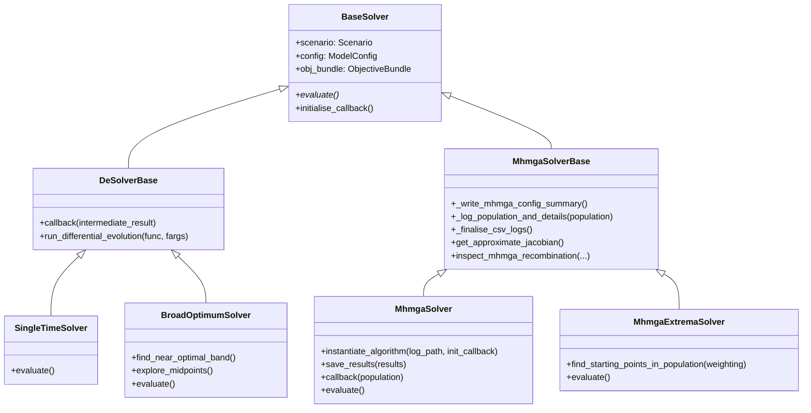

# Module Summary: `firm_ce.optimisation`

**Source Folder:** [`src/firm_ce/optimisation/`](./src/firm_ce/optimisation)

## Overview

The `firm_ce.optimisation` subpackage connects `firm_ce`'s operational simulation backends (`backend.scalar` and `backend.tensor`) to external optimisation algorithms: **SciPy Differential Evolution** (`scipy.optimize.differential_evolution`) and the **Metapopulation Historical Modelling to Generate Alternatives (`mga`)** framework. It provides an objective routing factory (`objective_factory.py`), a hierarchy of solver classes (`solver.py`), graceful `SIGINT` (`Ctrl+C`) interrupt handling during Numba execution, and streaming binary-to-CSV population log management.

---

## Contents & Key Functionality

### 1. [`objective_factory.py`](./src/firm_ce/optimisation/objective_factory.py) — `ObjectiveBundle` & Routing Factory
Routes a `(scenario, config)` pair to the exact compiled population wrapper function, static argument tuple, MGA space projection configuration, and pre-allocated operational `details` array:
- **[`ObjectiveBundle` Dataclass](./src/firm_ce/optimisation/objective_factory.py#L27-L35)**:
  - Frozen dataclass bundling `func` (`Callable`), `fargs` (`Tuple`), `return_scaled` (`bool`), `space_scaler` (`Optional[np.ndarray]`), `scaled_ndim` (`Optional[int]`), and `details` (`Optional[np.ndarray]`).
- **[`build_objective_bundle(scenario, config)`](./src/firm_ce/optimisation/objective_factory.py#L94-L216)**:
  - **Single-Time / Broad Optimum (`single_time`, `near_optimum`, `midpoint_explore`)**: Binds `firm_ce.backend.scalar.single_time.evaluate_vectorised_xs`.
  - **MHMGA — Capacity Basis (`mga_space_basis == "capacity"`)**:
    - Builds the linear projection matrix `space_scaler = scenario.build_capacity_space_scaler()` (`return_scaled = False`) and allocates `details` of shape `(total_niches, max_pop_size, details_length)` when `save_details == True`.
    - Selects `mga_wrapper` / `mga_wrapper_with_details` (`backend == "scalar"`) or `mga_tensor_wrapper` / `mga_tensor_wrapper_with_details` (`backend == "tensor"`).
  - **MHMGA — Energy Basis (`mga_space_basis == "energy"`)**:
    - Resolves integer codes `(norm_code, agg_code, scaled_ndim)` via `_resolve_energy_space_dims` (`return_scaled = True`, `space_scaler = None`) so the backend computes non-linear energy-space coordinates inside the parallel evaluation loop.
    - Selects `mga_tensor_wrapper_scaled` (`backend == "tensor"`) or `mga_scalar_wrapper_scaled` (`backend == "scalar"`).

### 2. [`solver.py`](./src/firm_ce/optimisation/solver.py) — Solver Hierarchy & Log Recovery
Defines the solver strategy hierarchy instantiated via the [`get_solver(scenario, initial_population)`](./src/firm_ce/optimisation/solver.py#L1047-L1070) factory:

#### Solver Class Hierarchy

- **[`SingleTimeSolver`](./src/firm_ce/optimisation/solver.py#L304-L323)**: Runs vectorised SciPy `differential_evolution` to find the single least-cost capacity expansion solution, logging each generation's best candidate (`callback.csv`, `current_optimum.csv`) and full population (`population.bin`, `latest_population.npy`).
- **[`BroadOptimumSolver`](./src/firm_ce/optimisation/solver.py#L325-L445)**: Runs min/max capacity band searches (`"near_optimum"`) or evenly spaced midpoint searches (`"midpoint_explore"`) across asset groups within `1 + near_optimal_tol` of the optimal LCOE.
- **[`MhmgaSolver`](./src/firm_ce/optimisation/solver.py#L654-L891)**:
  - Wraps `mga.problem_definition.OptimizationProblem` and `mga.mhmga.MGAProblem`.
  - Supports warm-restarting (`restart_optimisation == True`) from `population.bin`, `latest_population.npy`, or `latest_population.csv`.
  - Executes multi-step MHMGA evolution (`mga_steps`), dynamically updating hyperparameters (`max_iter`, `pop_size`, `champ_count`, `elite_count`, `tourn_count`, `tourn_size`, `mutation_prob`, `mutation_sigma`, `crossover_prob`, `niche_elitism`, `noptimal_rel`, `noptimal_abs`, `fitness_method`) and adding new diversity niches (`mga_new_div_niches[step]`) at each step.
  - Writes `mhmga_config.json`, `mga_logs/mga_alternatives.csv`, and binary population/details logs, converting them to CSV in a `finally:` block.
- **[`MhmgaExtremaSolver`](./src/firm_ce/optimisation/solver.py#L893-L1045)**:
  - Searches for geometric min/max extrema along individual decision variables (`construct_variable_weightings`), technology groups (`construct_unit_type_weightings`), and nodes (`construct_node_weightings`), seeded from an existing near-optimal population file.
- **Interrupt Safety & Binary Log Utilities**:
  - **[`graceful_sigint_handler(algorithm, logger)`](./src/firm_ce/optimisation/solver.py#L35-L65)**: Context manager that intercepts `SIGINT` (`Ctrl+C`) during Numba execution, setting `algorithm._stop_requested = True` so the current iteration completes cleanly and logs are finalised (pressing `Ctrl+C` 3 times force-exits immediately).
  - **[`convert_binary_logs_to_csv`](./src/firm_ce/optimisation/solver.py#L67-L142)**: Uses chunked `np.memmap` streaming to convert multi-gigabyte `population.bin` and `details.bin` files (plus `latest_*.npy` snapshots) to `.csv` without exhausting RAM.
  - **[`recover_interrupted_run`](./src/firm_ce/optimisation/solver.py#L144-L219)**: Repairs torn trailing bytes in `population.bin` / `details.bin` after a hard crash, converts binary logs to CSV, reconstructs `current_optimum.csv`, and returns the best feasible decision vector `best_x`.

---

## How It Fits into the Project

`firm_ce.optimisation` is invoked by [`Scenario.solve()`](./src/firm_ce/system/scenario.py#L754-L760) (as well as `Scenario.inspect_mhmga_recombination`, `Scenario.recover_logs`, and `Scenario.polish`). It decouples metaheuristic search algorithms from the underlying physics simulation in `firm_ce.backend`, and produces the optimal/near-optimal decision vectors and historical `population.bin` / `details.bin` archives analysed by `firm_ce.analysis`.
